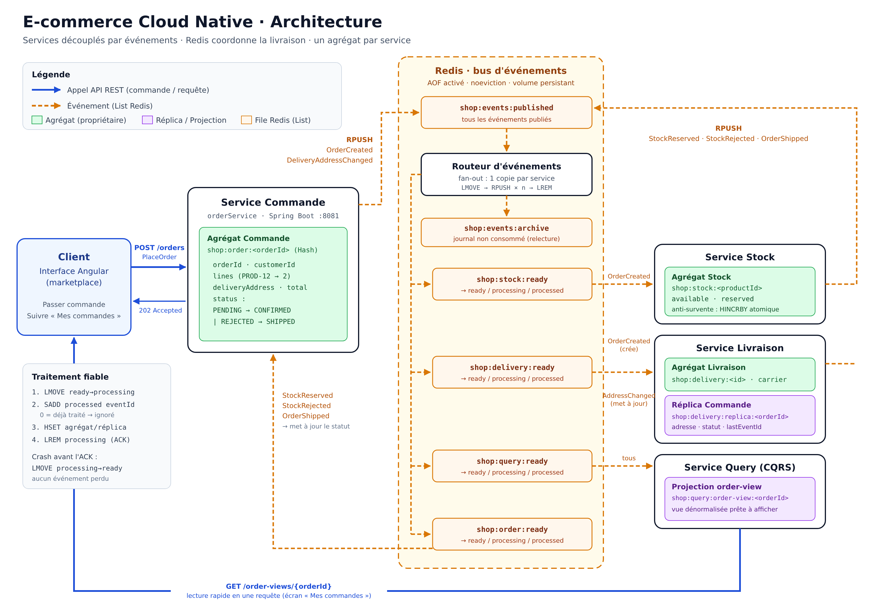
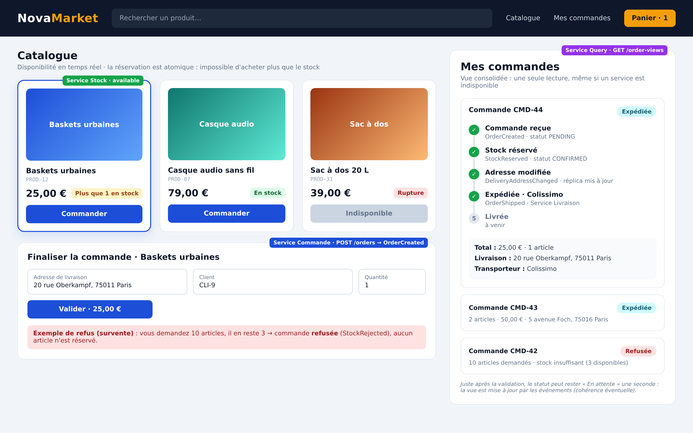

# Marketplace e-commerce – Projet NoSQL

Ce projet de groupe a pour objectif la conception d'une application marketplace e-commerce cloud native composée de plusieurs services découplés par événements.

---

## Sommaire

<details>
<summary><b>Partie 1 : Préparation du projet</b></summary>

- [Étape 1 : Initier le projet](#étape-1--initier-le-projet)
- [Étape 2 : Définir les services et leurs commandes](#étape-2--définir-les-services-et-leurs-commandes)
- [Étape 3 : Définir les agrégats des services](#étape-3--définir-les-agrégats-des-services)
- [Étape 4 : Découpler les services](#étape-4--découpler-les-services)
- [Étape 6 : Projection des données vers de nouveaux services](#étape-6--projection-des-données-vers-de-nouveaux-services)
- [Choix des bases et arbitrages CAP / PACELC](#choix-des-bases-et-arbitrages-cap--pacelc)

</details>

<details>
<summary><b>Partie 2 : Projet NoSQL</b></summary>

- [Niveau 1 : Bases remplies et interrogeables](#niveau-1--bases-remplies-et-interrogeables)
  - [Chargement de Redis](#chargement-de-redis)
  - [Chargement de MongoDB](#chargement-de-mongodb)
- [Niveau 2 : Services programmés](#niveau-2--services-programmés)
- [Livrables](#livrables)

</details>

---

## Étape 1 – Initier le projet

- Création d'une équipe de 2 personnes :
  - Loïc AKAMGA [@LOIC754](https://github.com/LOIC754)
  - Deiss YEHOUENOU [@CharmanY](https://github.com/CharmanY)
- Dépôt Git créé, enseignant invité :
  - [Dépôt](https://github.com/LOIC754/Maketplace_ecommerce_nosql.git)
- Descriptif du projet : ce README.

---

## Étape 2 – Définir les services et leurs commandes

Définir les services de notre application revient à modéliser ses données. Contrairement aux bases de données relationnelles, où la modélisation repose entièrement sur les relations entre les différentes tables, les bases NoSQL reposent plutôt sur les besoins de lecture et d'écriture des applications, qui traduisent les besoins métier ou utilisateur. On parle de modélisation orientée requêtes, qui se caractérise par les motifs d'accès (lecture, écriture).

Un service est donc une petite application indépendante qui prend en charge une seule capacité métier. Elle possède ses propres données et communique avec les autres services uniquement par des API ou des événements.
Un service se caractérise par :

- **une capacité métier claire :** elle se traduit par ce que l'entreprise propose au client. Dans notre cas d'une marketplace, on peut avoir la livraison, la commande, les stocks, le service après-vente, les avis ;
- **son agrégat :** il se définit comme une frontière transactionnelle métier, c'est-à-dire une limite entre les différents services. Il possède ses propres données associées à son service, dont il est le seul à pouvoir effectuer des modifications. Ses données sont toujours modifiées en bloc et aucun autre service ne peut les modifier ;
- **il reçoit des ordres :** ce sont des demandes de traitement (commandes) qui permettent à un service d'effectuer une action qui modifie ses données. Le service peut aussi les refuser si elles ne respectent pas ses règles métier ;
- **il est déployé séparément :** c'est-à-dire qu'il possède son propre conteneur, son propre code, et il peut tomber en panne ou être mis à jour sans arrêter les autres services.

L'écriture (W) est une opération qui consiste à créer ou modifier une donnée d'un service à une certaine fréquence. Elle se caractérise par une contrainte d'atomicité (tout ou rien, immédiat ou avec un délai). Exemples : W1 passer une commande (fréquente, atomique) ; W2 modifier l'adresse de livraison (rare, atomique) ; W3 réserver le stock d'un produit (fréquente, atomicité stricte car aucune survente n'est tolérée) ; W4 réapprovisionner un produit (rare, atomique) ; W5 expédier une commande (moyenne, tolère un délai).

La lecture (R) est une requête précise, avec ses filtres et son tri. Exemples : R1 obtenir une commande (par `orderId`) ; R2 connaître le stock disponible d'un produit (par `productId`) ; R3 obtenir les commandes à expédier (commandes confirmées, triées par date croissante) ; R4 afficher la liste des commandes d'un client (par `customerId`, triées par date décroissante).

La volumétrie estime le nombre de données et leur taille moyenne. Elle sert à repérer les partitions chaudes (*hot partitions*), c'est-à-dire une clé sollicitée par tout le monde en même temps. Exemple : le stock d'un produit en promotion. Dans notre marketplace, les commandes se comptent en milliers par jour (environ 1 Ko chacune) et sont réparties par `orderId`, sans risque particulier. Les livraisons suivent le même rythme (une par commande confirmée, environ 500 octets). Le stock ne concerne que quelques milliers de produits (environ 100 octets chacun), mais c'est lui qui porte le risque de partition chaude.

Pour notre marketplace e-commerce, nous nous sommes limités à 4 services. L'application est découpée par **capacité métier**, c'est-à-dire un service par capacité.

- **Service Commande** (`orderService`) reçoit la commande du client et émet les événements de commande (écritures W1, W2 ; lecture R1) ;
- **Service Stock** (`stockService`) réserve les articles et empêche la survente (écritures W3, W4 ; lecture R2) ;
- **Service Livraison** (`deliveryService`) prépare et expédie la commande à partir d'un réplica de la Commande (écriture W5 ; lecture R3) ;
- **Service Query** (`orderQueryService`) construit une vue consolidée pour l'affichage client (lecture R4). C'est le nouveau service alimenté par projection à l'étape 6.

Les commandes ci-dessous décrivent, pour chaque service, l'ordre reçu et les données nécessaires pour l'exécuter.

#### Service Commande

```json
{
  "command": "PlaceOrder",
  "service": "Commande",
  "endpoint": "POST /orders",
  "data": {
    "orderId": "CMD-1",
    "customerId": "CLI-1",
    "lines": [
      { "productId": "PROD-1", "quantity": 2, "unitPrice": 25.0 }
    ],
    "deliveryAddress": "8 rue Lafayette, 75009 Paris"
  }
}
```

```json
{
  "command": "ChangeDeliveryAddress",
  "service": "Commande",
  "endpoint": "PATCH /orders/CMD-1/address",
  "data": {
    "orderId": "CMD-1",
    "deliveryAddress": "20 rue Oberkampf, 75011 Paris"
  }
}
```

#### Service Stock

```json
{
  "command": "RestockProduct",
  "service": "Stock",
  "endpoint": "POST /stock/PROD-1/restock",
  "data": {
    "productId": "PROD-1",
    "quantity": 50
  }
}
```

> La réservation du stock (W3) n'est **pas** une commande envoyée par le client : elle est déclenchée par l'événement de création de commande (étape 4).

#### Service Livraison

```json
{
  "command": "ShipOrder",
  "service": "Livraison",
  "endpoint": "POST /deliveries/CMD-1/ship",
  "data": {
    "orderId": "CMD-1",
    "carrier": "Colissimo"
  }
}
```

**Problème métier traité** : un client passe une commande sur une marketplace. La commande doit être validée par rapport au stock disponible, **sans survente** (exemple : un client commande 10 articles alors qu'il n'en reste que 3), puis être livrée. Enfin, après son achat, le client peut se connecter à la marketplace pour voir où en est sa commande, c'est-à-dire un bref résumé de son achat.

### Maquette de l'app et architecture





### Processus

#### A. Naissance de l'événement (service Commande)

Lorsque le client passe une commande (`POST /orders`), le service Commande crée son agrégat dans sa base MongoDB (`db.orders.insertOne({ orderId: "CMD-1", …, status: "PENDING" })`), puis construit l'événement associé à cette commande en JSON et le dépose dans la file d'entrée Redis (`RPUSH shop:events:published '<json>'`). Il envoie ensuite un message « Accepted » au client, mais pour le service Commande la commande est encore en attente.

#### B. Passage par le routeur

Le routeur est un programme Python qui tourne en boucle et a pour objectif de parcourir `shop:events:published`. S'il y a de nouveaux événements, il les récupère, en fait une copie et la dépose dans la file de chaque service concerné (`shop:stock:ready`, `shop:delivery:ready`, `shop:query:ready`, et `shop:order:ready` pour les événements destinés au service Commande), puis recommence la boucle. Il garde aussi une copie de chaque événement dans `shop:events:archive`, qui sert de journal.

**Redis coordonne la livraison des événements** entre services. Le routeur copie chaque événement dans **une file par service consommateur**, car une List Redis est consommée de façon destructive (`LPOP` / `LMOVE`) : avec une file partagée, un événement ne serait reçu que par un seul service.

**REMARQUE :** le routeur prend l'événement de façon atomique, c'est-à-dire de façon indivisible. Avec `LMOVE`, l'événement est retiré de `shop:events:published` et ajouté dans une file de traitement en une seule opération. Il est donc toujours à un endroit connu et n'est jamais perdu, même si le routeur tombe en panne au milieu du traitement.

#### C. Consommation par les trois services, en parallèle

Chaque service récupère l'événement dans sa file (`LMOVE shop:<service>:ready shop:<service>:processing`), vérifie qu'il ne l'a pas déjà traité grâce à son `eventId` (`SADD shop:<service>:processed <eventId>`), le traite, puis l'acquitte (`LREM shop:<service>:processing`). Pour `OrderCreated_v1`, le service Stock réserve les articles, le service Livraison crée son réplica de la commande et le service Query crée la vue de la commande. Le résultat de la réservation repart ensuite sous forme d'un nouvel événement (`StockReserved_v1` ou `StockRejected_v1`) par le même chemin.

Le choix de la base de données pour chaque agrégat est détaillé dans la partie [Choix des bases et arbitrages CAP / PACELC](#choix-des-bases-et-arbitrages-cap--pacelc).

---

## Étape 3 – Définir les agrégats des services

Un agrégat est un ensemble de données qui forme une unité cohérente délimitant les transactions métier. Il se caractérise par le fait que les opérations (lecture, écriture) ou modifications qui lui sont appliquées s'exécutent en un seul bloc : on parle alors de transaction locale.
En NoSQL, cet agrégat devient un document MongoDB ou un Hash Redis : une seule clé, toutes les données dedans, sans jointure.
Une transaction est un ensemble de modifications qui réussissent toutes ensemble ou pas du tout.
Elle est locale quand elle ne touche que les données d'un seul service, dans sa propre base.
Exemple d'une transaction locale : le client ajoute un article à CMD-1. Il faut ajouter la ligne et recalculer le total. Les deux changements sont dans le même agrégat, donc ils sont écrits en une seule opération dans la base du service Commande. Le total ne peut jamais être faux, même une fraction de seconde.
Racine d'agrégat (*aggregate root*). C'est l'entité principale, qui porte l'identifiant de l'agrégat et sert de seule porte d'entrée. Exemple : on ne modifie jamais une ligne de commande directement, on passe toujours par la commande (CMD-1), qui vérifie que tout reste cohérent.
Invariant métier. C'est une règle qui doit toujours être vraie à l'intérieur de l'agrégat. Exemple : « le total est égal à la somme des lignes ». Comme l'agrégat est modifié d'un bloc, l'invariant ne peut jamais être cassé à moitié.
Inclusion ou référence. Lorsqu'une donnée est lue et modifiée en même temps que l'agrégat, on l'inclut dedans (*embedding*) : une seule lecture suffit, sans jointure. Lorsqu'elle a sa propre vie ou appartient à un autre service, on ne garde que son identifiant (référence) : chaque service reste ainsi maître de ses données.

### Agrégat Commande (service Commande)

**Racine :** `orderId`

```json
{
  "orderId": "CMD-1",
  "customerId": "CLI-1",
  "lines": [
    { "productId": "PROD-1", "productName": "Baskets urbaines", "quantity": 2, "unitPrice": 25.0 },
    { "productId": "PROD-2", "productName": "Casque audio", "quantity": 1, "unitPrice": 79.0 }
  ],
  "total": 129.0,
  "deliveryAddress": "8 rue Lafayette, 75009 Paris",
  "status": "PENDING",
  "createdAt": "2026-10-29T10:00:00Z",
  "updatedAt": "2026-10-29T10:00:00Z"
}
```

- **Invariants :**
  - `total` = somme de `quantity × unitPrice` des lignes ;
  - une commande contient au moins une ligne, et chaque `quantity` est supérieure à 0 ;
  - le statut suit le cycle `PENDING` → `CONFIRMED` ou `REJECTED` → `SHIPPED`.
- **Inclusion :** les `lines`, qui ont le même cycle de vie que la commande. Le `unitPrice` et le `productName` sont une **copie figée** au moment de l'achat.
- **Référence :** `customerId` et `productId`, qui sont gérés par d'autres domaines.

### Agrégat Stock (service Stock)

**Racine :** `productId`

```json
{
  "productId": "PROD-1",
  "name": "Baskets urbaines",
  "price": 25.0,
  "available": 3,
  "reserved": 0,
  "updatedAt": "2026-10-29T09:00:00Z"
}
```

- **Invariants :**
  - `available` ≥ 0 : **aucune survente** ;
  - une réservation retire de `available` et ajoute à `reserved`, en une seule opération atomique.
- **Agrégat petit et isolé par produit :** chaque réservation ne verrouille qu'un seul produit. C'est la réponse au risque de **partition chaude** identifié dans la volumétrie.

### Agrégat Livraison (service Livraison)

**Racine :** `deliveryId`

```json
{
  "deliveryId": "LIV-1",
  "orderId": "CMD-1",
  "carrier": null,
  "trackingNumber": null,
  "status": "WAITING",
  "createdAt": "2026-10-29T10:00:05Z",
  "shippedAt": null
}
```

- **Invariants :**
  - le statut suit le cycle `WAITING` → `SHIPPED` ;
  - `carrier` et `shippedAt` sont obligatoires dès que le statut vaut `SHIPPED`.
- **Référence :** `orderId`, car la commande appartient au service Commande. Les données de la commande dont Livraison a besoin (adresse, articles) sont obtenues par **réplication** à l'étape 4.

En résumé, les lignes de commande sont incluses dans la commande, car elles ont le même cycle de vie. Le prix et le nom du produit sont inclus dans chaque ligne sous forme de copie figée, pour conserver l'historique de l'achat même si le prix change plus tard. Le client est référencé par `customerId`, car son domaine est hors du périmètre du projet. Le produit est référencé par `productId`, car ses quantités appartiennent au service Stock. Enfin, la commande est référencée dans la livraison par `orderId`, et ses données utiles sont obtenues par réplication.

---

## Étape 4 – Découpler les services

Couplage. Deux services sont couplés quand l'un a besoin de l'autre pour fonctionner. Si Livraison appelait Commande à chaque fois qu'il veut l'adresse d'une commande, une panne de Commande bloquerait aussi Livraison. Découpler, c'est supprimer cette dépendance.
Un événement est un fait passé, annoncé par un service. Il se caractérise par le fait qu'il est immuable, versionné et identifié par un `eventId` unique, ce qui permet d'ignorer un doublon (idempotence).
Émetteur et récepteur. L'émetteur publie l'événement sans savoir qui l'écoute. Le récepteur réagit en modifiant ses propres données, sans jamais modifier celles de l'émetteur.
Le réplica est une copie partielle de l'agrégat d'un autre service, que le récepteur garde chez lui. Exemple : le service Livraison garde une copie des seules informations de la commande dont il a besoin, sous forme de réplica. Ce réplica est en lecture seule : il n'est mis à jour que par les événements, et c'est toujours le service Commande qui fait autorité.

### Enveloppe commune des événements

Chaque événement est **immuable**, **versionné** et identifié par un `eventId` unique (déduplication).

```json
{
  "eventId": "evt-0001",
  "eventType": "OrderCreated",
  "eventVersion": 1,
  "occurredAt": "2026-10-29T10:00:00Z",
  "emitter": "Commande",
  "aggregateId": "CMD-1",
  "payload": {}
}
```

### Liste des événements

| Événement | Émetteur | Récepteur(s) | Donnée de l'agrégat modifiée | Nouvelle valeur | Rôle pour le réplica |
|---|---|---|---|---|---|
| `OrderCreated_v1` | Commande | Stock, Livraison | commande entière | `status = PENDING`, lignes, adresse | **crée** le réplica |
| `StockReserved_v1` | Stock | Commande, Livraison | `available`, `reserved` du produit | `status` de la commande → `CONFIRMED` | **met à jour** le réplica |
| `StockRejected_v1` | Stock | Commande, Livraison | aucune (réservation refusée) | `status` de la commande → `REJECTED` | **met à jour** le réplica |
| `DeliveryAddressChanged_v1` | Commande | Livraison | `deliveryAddress` | nouvelle adresse | **met à jour** le réplica |
| `OrderShipped_v1` | Livraison | Commande | `status`, `carrier`, `shippedAt` de la livraison | `status` de la commande → `SHIPPED` | — |

### Détail des événements

#### `OrderCreated_v1` : crée le réplica

```json
{
  "eventId": "evt-0001",
  "eventType": "OrderCreated",
  "eventVersion": 1,
  "occurredAt": "2026-10-29T10:00:00Z",
  "emitter": "Commande",
  "aggregateId": "CMD-1",
  "payload": {
    "orderId": "CMD-1",
    "customerId": "CLI-1",
    "lines": [
      { "productId": "PROD-1", "productName": "Baskets urbaines", "quantity": 2, "unitPrice": 25.0 },
      { "productId": "PROD-2", "productName": "Casque audio", "quantity": 1, "unitPrice": 79.0 }
    ],
    "total": 129.0,
    "deliveryAddress": "8 rue Lafayette, 75009 Paris",
    "status": "PENDING"
  }
}
```

- **Stock** tente de réserver chaque ligne. Si toutes les réservations réussissent, il publie `StockReserved_v1`. Si une seule échoue, il annule les réservations déjà faites et publie `StockRejected_v1`.
- **Livraison** crée son réplica de la commande.

#### `StockReserved_v1` : met à jour le réplica

```json
{
  "eventId": "evt-0002",
  "eventType": "StockReserved",
  "eventVersion": 1,
  "occurredAt": "2026-10-29T10:00:02Z",
  "emitter": "Stock",
  "aggregateId": "CMD-1",
  "payload": {
    "orderId": "CMD-1",
    "reservedLines": [
      { "productId": "PROD-1", "quantity": 2 },
      { "productId": "PROD-2", "quantity": 1 }
    ]
  }
}
```

- **Commande** passe la commande à `CONFIRMED`.
- **Livraison** met à jour le réplica (`orderStatus = CONFIRMED`) et crée son agrégat Livraison `LIV-1` au statut `WAITING`.

#### `StockRejected_v1` : met à jour le réplica

```json
{
  "eventId": "evt-0003",
  "eventType": "StockRejected",
  "eventVersion": 1,
  "occurredAt": "2026-10-29T10:00:02Z",
  "emitter": "Stock",
  "aggregateId": "CMD-2",
  "payload": {
    "orderId": "CMD-2",
    "reason": "INSUFFICIENT_STOCK",
    "productId": "PROD-1",
    "requested": 10,
    "available": 3
  }
}
```

- **Commande** passe la commande à `REJECTED`.
- **Livraison** met à jour le réplica (`orderStatus = REJECTED`) : la commande ne sera pas expédiée.

#### `DeliveryAddressChanged_v1` : met à jour le réplica

```json
{
  "eventId": "evt-0004",
  "eventType": "DeliveryAddressChanged",
  "eventVersion": 1,
  "occurredAt": "2026-10-29T10:05:00Z",
  "emitter": "Commande",
  "aggregateId": "CMD-1",
  "payload": {
    "orderId": "CMD-1",
    "deliveryAddress": "20 rue Oberkampf, 75011 Paris"
  }
}
```

- **Livraison** remplace l'adresse dans son réplica.

#### `OrderShipped_v1`

```json
{
  "eventId": "evt-0005",
  "eventType": "OrderShipped",
  "eventVersion": 1,
  "occurredAt": "2026-10-29T14:00:00Z",
  "emitter": "Livraison",
  "aggregateId": "LIV-1",
  "payload": {
    "orderId": "CMD-1",
    "deliveryId": "LIV-1",
    "carrier": "Colissimo",
    "trackingNumber": "6A12345678901"
  }
}
```

- **Commande** passe la commande à `SHIPPED`.

### Le réplica : la commande vue par le service Livraison

Livraison ne copie que les données **utiles à son métier** : il n'a besoin ni du prix ni du client.

```json
{
  "orderId": "CMD-1",
  "deliveryAddress": "20 rue Oberkampf, 75011 Paris",
  "items": [
    { "productId": "PROD-1", "productName": "Baskets urbaines", "quantity": 2 },
    { "productId": "PROD-2", "productName": "Casque audio", "quantity": 1 }
  ],
  "orderStatus": "CONFIRMED",
  "lastEventId": "evt-0004",
  "updatedAt": "2026-10-29T10:05:00Z"
}
```

Le réplica est **créé** par `OrderCreated_v1`, avec l'identifiant de la commande, l'adresse, les articles et le statut `PENDING`. Il est ensuite **mis à jour** par `StockReserved_v1` (le statut passe à `CONFIRMED`), par `StockRejected_v1` (le statut passe à `REJECTED`) et par `DeliveryAddressChanged_v1` (l'adresse est remplacée). Le champ `lastEventId` garde la trace du dernier événement appliqué : un événement déjà traité est ignoré.

**Pourquoi répliquer ?**

- **Autonomie :** Livraison prépare et expédie les colis sans jamais interroger le service Commande.
- **Disponibilité :** si le service Commande est indisponible, Livraison continue de fonctionner avec son réplica.
- **Performance :** la lecture R3 (« commandes à expédier ») est locale, sans appel réseau vers un autre service.
- **Compromis :** le réplica peut avoir un léger retard sur la commande d'origine : c'est la **cohérence à terme** (*eventual consistency*).

---

## Étape 6 : Projection des données vers de nouveaux services

Le nouveau service est le service Query (`orderQueryService`), qui affiche l'écran « Mes commandes » du client et répond à la lecture R4. Il applique le **CQRS** (*Command Query Responsibility Segregation*) : on sépare le modèle d'écriture, c'est-à-dire les agrégats Commande, Stock et Livraison qui restent la source de vérité, du modèle de lecture, une vue dénormalisée préparée uniquement pour être affichée rapidement.

Ce service ne lit pas les bases des autres services, sinon il redeviendrait couplé à eux. Il s'abonne à leurs **événements** et construit sa propre vue : c'est la **projection**.

### Agrégat de la projection : `order_view`

Un document **par commande**, qui rassemble des données issues de trois services :

```json
{
  "orderId": "CMD-1",
  "customerId": "CLI-1",
  "createdAt": "2026-10-29T10:00:00Z",
  "total": 129.0,
  "itemsCount": 3,
  "items": [
    { "productName": "Baskets urbaines", "quantity": 2 },
    { "productName": "Casque audio", "quantity": 1 }
  ],
  "deliveryAddress": "20 rue Oberkampf, 75011 Paris",
  "status": "SHIPPED",
  "statusLabel": "Expédiée",
  "carrier": "Colissimo",
  "trackingNumber": "6A12345678901",
  "timeline": [
    { "status": "PENDING",   "label": "Commande reçue", "at": "2026-10-29T10:00:00Z" },
    { "status": "CONFIRMED", "label": "Stock réservé",  "at": "2026-10-29T10:00:02Z" },
    { "status": "SHIPPED",   "label": "Expédiée",       "at": "2026-10-29T14:00:00Z" }
  ],
  "appliedEventIds": ["evt-0001", "evt-0002", "evt-0004", "evt-0005"],
  "updatedAt": "2026-10-29T14:00:00Z"
}
```

**Transformations par rapport aux données d'origine :**

- `itemsCount` est **calculé** (somme des quantités) ;
- `statusLabel` traduit le statut technique en **texte lisible** pour le client ;
- `timeline` **historise** chaque changement de statut, alors que l'agrégat Commande ne garde que le statut courant ;
- `carrier` et `trackingNumber` viennent du service **Livraison** ;
- les prix unitaires sont **retirés** des articles : l'écran n'affiche que le total.

**Événements consommés par le service Query :** `OrderCreated_v1` crée le document (client, articles, total, adresse, statut `PENDING`). `StockReserved_v1` passe le statut à `CONFIRMED` et l'ajoute à la timeline. `StockRejected_v1` passe le statut à `REJECTED`, avec le libellé « Refusée ». `DeliveryAddressChanged_v1` met à jour l'adresse. `OrderShipped_v1` passe le statut à `SHIPPED` et renseigne le transporteur et le numéro de suivi.

Le projecteur, c'est-à-dire le composant qui applique les événements à la vue, est **idempotent** : un événement dont l'`eventId` figure déjà dans `appliedEventIds` est ignoré. La projection peut aussi être **reconstruite entièrement** en rejouant les événements conservés dans l'archive (*replay*). Enfin, la vue peut avoir un léger retard : juste après une commande, le client peut voir « Commande reçue » une seconde avant « Stock réservé ».

Nous avons choisi **un document par commande** plutôt qu'un document par client contenant toutes ses commandes : la taille de chaque document reste bornée, et deux commandes d'un même client se mettent à jour indépendamment.

### Requêtes de la projection

Index nécessaires, correspondant exactement aux filtres et aux tris (guide, étape 3) :

```javascript
// Un seul document par commande
db.order_views.createIndex({ orderId: 1 }, { unique: true })
// R4 : filtre sur le client, tri par date décroissante
db.order_views.createIndex({ customerId: 1, createdAt: -1 })
```

**R4 : « Mes commandes » d'un client, les plus récentes d'abord**

```javascript
db.order_views.find(
  { customerId: "CLI-1" },
  { _id: 0, orderId: 1, createdAt: 1, total: 1, itemsCount: 1, statusLabel: 1 }
).sort({ createdAt: -1 }).limit(20)
```

**Détail d'une commande** (clic sur une commande dans la liste)

```javascript
db.order_views.findOne({ orderId: "CMD-1" }, { _id: 0, appliedEventIds: 0 })
```

L'index composé `{ customerId: 1, createdAt: -1 }` sert à la fois le filtre et le tri de R4, sans tri en mémoire.

---

## Choix des bases et arbitrages CAP / PACELC

Il s'agit d'associer chaque agrégat à un modèle NoSQL : on choisit la base en fonction du motif d'accès.

- Clé-valeur (Redis) : accès par clé, en mémoire, très rapide, avec des opérations atomiques comme les compteurs ;
- Document (MongoDB) : objets imbriqués, lus et écrits d'un bloc, avec des index secondaires pour filtrer et trier ;
- Colonnes larges (Cassandra) : très gros volumes écrits en continu, lus par intervalle (séries temporelles).

Dans notre projet, l'agrégat Commande est stocké dans MongoDB (base `order_db`, collection `orders`). L'agrégat Stock est stocké dans Redis, sous forme de Hash (`stock:<productId>`). L'agrégat Livraison et le réplica de la Commande sont stockés dans MongoDB (base `delivery_db`, collections `deliveries` et `order_replicas`). La projection est stockée dans MongoDB (base `query_db`, collection `order_views`). Les événements circulent dans Redis, sous forme de Lists et de Sets. Chaque service possède ainsi sa **propre base logique** : aucun service ne lit la base d'un autre.

### Justification des choix

**MongoDB (modèle document) pour la Commande, la Livraison, le réplica et la projection**
- Un agrégat correspond à **un document** : la commande et ses lignes imbriquées sont lues et écrites en une seule opération, qui est **atomique sur un document**.
- Les **index secondaires** répondent aux lectures filtrées et triées (R3, R4).
- Le schéma flexible accepte les évolutions, par exemple l'ajout de la `timeline` dans la projection.

**Redis (modèle clé-valeur) pour le Stock**
- La réservation (W3) exige une **atomicité stricte** : `HINCRBY` décrémente et renvoie la nouvelle valeur en une seule opération, ce qui empêche toute survente.
- Les données sont en **mémoire** : latence très faible, adaptée au risque de **partition chaude** (beaucoup de réservations simultanées sur un produit en promotion).
- Le stock est un petit agrégat plat (quelques champs numériques) : un Hash suffit.
- *Alternative étudiée :* MongoDB permet aussi une réservation atomique (`updateOne` conditionné par `available >= quantité` avec `$inc`). Redis est retenu pour sa latence sous forte concurrence.

**Redis (Lists) pour les événements**
- Une List par service consommateur : un événement reste en attente tant que le service ne l'a pas traité, même s'il est arrêté.
- `LMOVE` transfère un événement de façon **atomique** vers une file de traitement : aucun événement n'est perdu en cas de panne.
- Un Set par service enregistre les `eventId` déjà traités (**idempotence**).
- Persistance assurée par l'**AOF** et un volume Docker.

**Pas de base orientée colonnes larges**
- Aucun motif d'accès ne porte sur de très gros volumes écrits en continu et lus par intervalle de temps. Deux bases couvrent tous les besoins, conformément au cahier des charges.

### Index MongoDB

```javascript
// order_db.orders : R1 par identifiant
db.orders.createIndex({ orderId: 1 }, { unique: true })

// delivery_db.deliveries : R3, livraisons à expédier par date
db.deliveries.createIndex({ orderId: 1 }, { unique: true })
db.deliveries.createIndex({ status: 1, createdAt: 1 })

// delivery_db.order_replicas : un réplica par commande
db.order_replicas.createIndex({ orderId: 1 }, { unique: true })

// query_db.order_views : R4, commandes d'un client, les plus récentes d'abord
db.order_views.createIndex({ orderId: 1 }, { unique: true })
db.order_views.createIndex({ customerId: 1, createdAt: -1 })
```

### Arbitrages CAP / PACELC

Le théorème CAP impose un choix en cas de partition réseau entre deux machines de la base : soit on refuse l'opération pour préserver la cohérence (**CP**), soit on répond quand même avec une donnée peut-être en retard (**AP**). PACELC complète ce choix pour le fonctionnement normal, sans panne : on privilégie soit la latence (**EL**), soit la cohérence (**EC**). Ce choix se fait opération par opération.

- **Réserver le stock (W3) : CP et EC.** Une survente est inacceptable : mieux vaut refuser une commande que vendre un article inexistant. Les lectures et les écritures se font uniquement sur le nœud principal.
- **Créer une commande (W1) : CP et EC.** La commande est la source de vérité : l'écriture est confirmée par la majorité des nœuds (`writeConcern: majority`).
- **Mettre à jour le réplica Livraison : AP et EL.** Un léger retard est tolérable, car la livraison n'intervient qu'après la confirmation du stock.
- **Afficher « Mes commandes » (R4) : AP et EL.** Mieux vaut afficher une vue en retard d'une seconde que ne rien afficher : la lecture peut se faire sur un nœud secondaire.
- **Publier un événement : AP et EL.** L'AOF écrit sur disque chaque seconde (`appendfsync everysec`) : la latence est bonne, au risque de perdre au plus une seconde d'événements en cas de coupure brutale. Les agrégats stockés dans MongoDB permettent de reconstruire les événements manquants.

> En développement, chaque base tourne sur un seul nœud : les partitions réseau sont théoriques. Ces choix décrivent le comportement attendu en production, avec un replica set MongoDB et une réplication Redis.

---